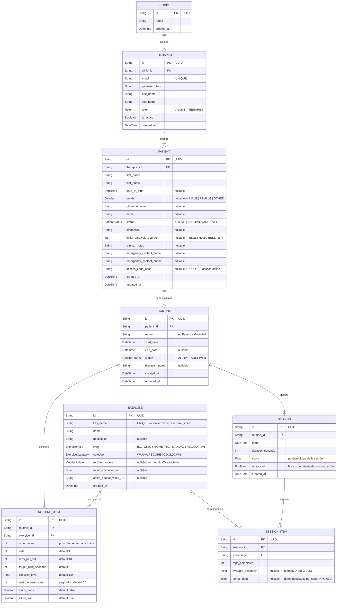

# Diagrama Entidad-Relación — Symma Platform

**Proyecto:** Symma Platform (Ecosistema de Rehabilitación de Parálisis Facial)
**Versión del Schema:** Producción (Sprint 0+)
**Fuente:** `packages/database/prisma/schema.prisma`
**Fecha de generación:** Mayo 2026

---

## 1. Diagrama ER

El siguiente diagrama representa el modelo de datos completo de la plataforma Symma tal como está definido en el schema de Prisma. Incluye todas las entidades, atributos con sus tipos de datos, claves primarias (PK) y foráneas (FK), y las relaciones con su cardinalidad exacta.

---

## 2. Descripción de Entidades

### 2.1. Clinic (Clínica)

**Tabla:** `clinics`

Representa la unidad institucional a la que pertenecen los terapeutas. Es la raíz jerárquica del sistema multitenancy de la plataforma.

| Atributo | Tipo | Restricciones | Descripción |
|---|---|---|---|
| `id` | `String` (UUID) | PK | Identificador único de la clínica |
| `name` | `String` | NOT NULL | Nombre comercial o razón social de la clínica |
| `created_at` | `DateTime` | NOT NULL, default now() | Fecha de alta en el sistema |

**Relaciones:**
- Una `Clinic` puede tener **uno o más** `Therapist` (1 : N).

---

### 2.2. Therapist (Terapeuta)

**Tabla:** `therapists`

Representa al profesional de salud que utiliza el portal web (Symma Web) para gestionar pacientes, diseñar rutinas y monitorear el progreso clínico. Posee credenciales de acceso propias al sistema.

| Atributo | Tipo | Restricciones | Descripción |
|---|---|---|---|
| `id` | `String` (UUID) | PK | Identificador único del terapeuta |
| `clinic_id` | `String` (UUID) | FK → `clinics.id`, NOT NULL | Clínica a la que pertenece |
| `email` | `String` | UNIQUE, NOT NULL | Correo electrónico para autenticación |
| `password_hash` | `String` | NOT NULL | Hash de la contraseña (bcrypt o similar) |
| `first_name` | `String` | NOT NULL | Nombre(s) del terapeuta |
| `last_name` | `String` | NOT NULL | Apellido(s) del terapeuta |
| `role` | `Role` | NOT NULL, default `THERAPIST` | Nivel de acceso en el sistema |
| `is_active` | `Boolean` | NOT NULL, default `true` | Permite deshabilitar cuentas sin eliminarlas |
| `created_at` | `DateTime` | NOT NULL, default now() | Fecha de alta en el sistema |

**Relaciones:**
- Un `Therapist` pertenece a **una** `Clinic` (N : 1).
- Un `Therapist` puede atender **uno o más** `Patient` (1 : N).

---

### 2.3. Patient (Paciente)

**Tabla:** `patients`

Entidad central del dominio clínico. Almacena los datos personales, clínicos y de contacto del paciente con parálisis facial. El campo `access_code_hash` habilita la autenticación local en la aplicación móvil sin requerir conexión a internet.

| Atributo | Tipo | Restricciones | Descripción |
|---|---|---|---|
| `id` | `String` (UUID) | PK | Identificador único del paciente |
| `therapist_id` | `String` (UUID) | FK → `therapists.id`, NOT NULL | Terapeuta responsable |
| `first_name` | `String` | NOT NULL | Nombre(s) del paciente |
| `last_name` | `String` | NOT NULL | Apellido(s) del paciente |
| `date_of_birth` | `DateTime` | nullable | Fecha de nacimiento |
| `gender` | `Gender` | nullable | Género del paciente |
| `phone_number` | `String` | nullable | Teléfono de contacto |
| `email` | `String` | nullable | Correo electrónico del paciente |
| `status` | `PatientStatus` | NOT NULL, default `ACTIVE` | Estado clínico actual del paciente |
| `diagnosis` | `String` | nullable | Descripción textual del diagnóstico |
| `initial_paralysis_degree` | `Int` | nullable | Grado inicial según Escala House-Brackmann (1–6) |
| `clinical_notes` | `String` | nullable | Notas clínicas adicionales del terapeuta |
| `emergency_contact_name` | `String` | nullable | Nombre del contacto de emergencia |
| `emergency_contact_phone` | `String` | nullable | Teléfono del contacto de emergencia |
| `access_code_hash` | `String` | UNIQUE, nullable | Hash del código de acceso para autenticación offline en la app móvil |
| `created_at` | `DateTime` | NOT NULL, default now() | Fecha de alta en el sistema |
| `updated_at` | `DateTime` | NOT NULL, auto-update | Última modificación del registro |

**Relaciones:**
- Un `Patient` es atendido por **un** `Therapist` (N : 1).
- Un `Patient` puede tener **una o más** `Routine` asignadas (1 : N).

**Nota de diseño:** El campo `access_code_hash` reemplaza al campo `auth_pin_hash` del brief original. Este cambio nominaliza el concepto como "código de acceso" en lugar de "PIN", permitiendo mayor flexibilidad en el mecanismo de autenticación offline.

---

### 2.4. Exercise (Ejercicio)

**Tabla:** `exercises`

Catálogo maestro de ejercicios de rehabilitación facial. Cada entrada define un ejercicio reutilizable que puede incluirse en múltiples rutinas y sesiones. El campo `key_name` actúa como identificador semántico para el sistema de internacionalización (i18n).

| Atributo | Tipo | Restricciones | Descripción |
|---|---|---|---|
| `id` | `String` (UUID) | PK | Identificador único del ejercicio |
| `key_name` | `String` | UNIQUE, NOT NULL | Clave i18n (ej: `exercise_smile`, `exercise_brows_raise`) |
| `name` | `String` | NOT NULL | Nombre descriptivo del ejercicio |
| `description` | `String` | nullable | Descripción clínica detallada del ejercicio |
| `type` | `ExerciseType` | NOT NULL | Clasificación biomecánica del movimiento |
| `category` | `ExerciseCategory` | NOT NULL | Posición dentro de la secuencia de una sesión |
| `mobile_module` | `MobileModule` | nullable | Módulo de visión computacional de MediaPipe asociado |
| `asset_animation_url` | `String` | nullable | URL del asset de animación para guía visual |
| `asset_tutorial_video_url` | `String` | nullable | URL del video tutorial del ejercicio |
| `created_at` | `DateTime` | NOT NULL, default now() | Fecha de creación en el catálogo |

**Relaciones:**
- Un `Exercise` puede formar parte de **cero o más** `RoutineItem` (1 : N).
- Un `Exercise` puede tener **cero o más** `SessionItem` asociados (1 : N).

---

### 2.5. Routine (Rutina)

**Tabla:** `routines`

Representa la prescripción terapéutica formal que el terapeuta diseña para un paciente. Una rutina agrupa un conjunto ordenado de ejercicios con parámetros personalizados y tiene una vigencia temporal definida por `start_date` y `end_date`.

| Atributo | Tipo | Restricciones | Descripción |
|---|---|---|---|
| `id` | `String` (UUID) | PK | Identificador único de la rutina |
| `patient_id` | `String` (UUID) | FK → `patients.id`, NOT NULL | Paciente al que pertenece la rutina |
| `name` | `String` | NOT NULL | Nombre descriptivo (ej: "Fase 1 - Movilidad Básica") |
| `start_date` | `DateTime` | NOT NULL | Fecha de inicio de la prescripción |
| `end_date` | `DateTime` | nullable | Fecha de fin (null = sin fecha de caducidad) |
| `status` | `RoutineStatus` | NOT NULL, default `ACTIVE` | Estado de la rutina |
| `therapist_notes` | `String` | nullable | Instrucciones o anotaciones del terapeuta |
| `created_at` | `DateTime` | NOT NULL, default now() | Fecha de creación |
| `updated_at` | `DateTime` | NOT NULL, auto-update | Última modificación |

**Relaciones:**
- Una `Routine` pertenece a **un** `Patient` (N : 1).
- Una `Routine` contiene **uno o más** `RoutineItem` (1 : N, con cascada de eliminación).
- Una `Routine` puede generar **cero o más** `Session` (1 : N, con cascada de eliminación).

---

### 2.6. RoutineItem (Ítem de Rutina)

**Tabla:** `routine_items`

Representa la instancia de un ejercicio dentro de una rutina específica, con todos los parámetros de ejecución personalizados para el paciente. Es la entidad que vincula el catálogo de ejercicios con la prescripción clínica individual.

| Atributo | Tipo | Restricciones | Descripción |
|---|---|---|---|
| `id` | `String` (UUID) | PK | Identificador único del ítem |
| `routine_id` | `String` (UUID) | FK → `routines.id`, NOT NULL | Rutina a la que pertenece (CASCADE DELETE) |
| `exercise_id` | `String` (UUID) | FK → `exercises.id`, NOT NULL | Ejercicio del catálogo referenciado |
| `order_index` | `Int` | NOT NULL | Posición del ejercicio dentro de la secuencia de la rutina |
| `sets` | `Int` | NOT NULL, default `1` | Número de series por ejercicio |
| `reps_per_set` | `Int` | NOT NULL, default `10` | Repeticiones por serie |
| `target_hold_seconds` | `Int` | NOT NULL, default `0` | Tiempo de sostenimiento del gesto (en segundos) |
| `difficulty_level` | `Float` | NOT NULL, default `1.0` | Nivel de dificultad (umbral de detección para MediaPipe) |
| `rest_between_sets` | `Int` | NOT NULL, default `10` | Tiempo de descanso entre series (en segundos) |
| `strict_mode` | `Boolean` | NOT NULL, default `false` | Si `true`, exige precisión máxima en el gesto |
| `allow_skip` | `Boolean` | NOT NULL, default `true` | Permite al paciente omitir el ejercicio |

**Relaciones:**
- Un `RoutineItem` pertenece a **una** `Routine` (N : 1).
- Un `RoutineItem` referencia **un** `Exercise` del catálogo (N : 1).

---

### 2.7. Session (Sesión)

**Tabla:** `sessions`

Registro de una ejecución completa de una rutina por parte del paciente. Captura los metadatos globales de la sesión: fecha, duración y puntaje general. El campo `is_synced` es crítico para la estrategia offline-first de la app móvil.

| Atributo | Tipo | Restricciones | Descripción |
|---|---|---|---|
| `id` | `String` (UUID) | PK | Identificador único de la sesión |
| `routine_id` | `String` (UUID) | FK → `routines.id`, NOT NULL | Rutina ejecutada (CASCADE DELETE) |
| `date` | `DateTime` | NOT NULL | Fecha y hora de realización de la sesión |
| `duration_seconds` | `Int` | NOT NULL | Duración total de la sesión en segundos |
| `score` | `Float` | NOT NULL | Puntaje global de la sesión (métrica compuesta) |
| `is_synced` | `Boolean` | NOT NULL, default `false` | Indica si la sesión fue enviada al servidor (`false` = pendiente) |
| `created_at` | `DateTime` | NOT NULL, default now() | Fecha de creación del registro (puede ser offline) |

**Relaciones:**
- Una `Session` pertenece a **una** `Routine` (N : 1).
- Una `Session` contiene **uno o más** `SessionItem` (1 : N, con cascada de eliminación).

---

### 2.8. SessionItem (Ítem de Sesión)

**Tabla:** `session_items`

Registro granular de la ejecución de **un ejercicio específico** dentro de una sesión. Almacena las métricas de rendimiento capturadas por el motor de visión computacional (MediaPipe). El campo `series_data` (JSON) permite guardar datos estructurados por serie para análisis retrospectivo avanzado.

| Atributo | Tipo | Restricciones | Descripción |
|---|---|---|---|
| `id` | `String` (UUID) | PK | Identificador único del ítem de sesión |
| `session_id` | `String` (UUID) | FK → `sessions.id`, NOT NULL | Sesión a la que pertenece (CASCADE DELETE) |
| `exercise_id` | `String` (UUID) | FK → `exercises.id`, NOT NULL | Ejercicio ejecutado |
| `reps_completed` | `Int` | NOT NULL | Número de repeticiones completadas |
| `average_accuracy` | `Float` | nullable | Precisión promedio del gesto detectada por IA — RFC-026 |
| `series_data` | `Json` | nullable | Datos detallados por serie (blendshapes, scores, timestamps) — RFC-030 |

**Relaciones:**
- Un `SessionItem` pertenece a **una** `Session` (N : 1).
- Un `SessionItem` referencia **un** `Exercise` del catálogo (N : 1).

---

## 3. Enums del Sistema

### 3.1. `Role` — Rol del Terapeuta

Define el nivel de acceso del terapeuta dentro del portal web Symma.

| Valor | Descripción |
|---|---|
| `THERAPIST` | Terapeuta regular. Puede gestionar sus propios pacientes y rutinas. |
| `ADMIN` | Administrador de clínica. Tiene acceso completo a todos los terapeutas y pacientes de la clínica. |

---

### 3.2. `Gender` — Género del Paciente

Catálogo para el dato demográfico de género del paciente, alineado a estándares clínicos modernos.

| Valor | Descripción |
|---|---|
| `MALE` | Masculino |
| `FEMALE` | Femenino |
| `OTHER` | Otro / No especificado |

---

### 3.3. `PatientStatus` — Estado del Paciente

Indica la situación clínica y operativa del paciente dentro del sistema.

| Valor | Descripción |
|---|---|
| `ACTIVE` | El paciente está en tratamiento activo. Puede acceder a la app móvil y ejecutar rutinas. |
| `INACTIVE` | El paciente pausó temporalmente el tratamiento. No se eliminan sus datos. |
| `ARCHIVED` | El paciente completó el tratamiento o fue dado de baja. El registro se preserva para historial. |

---

### 3.4. `ExerciseType` — Tipo de Ejercicio

Clasificación biomecánica del ejercicio, con relevancia clínica directa para el diseño de la terapia.

| Valor | Descripción clínica |
|---|---|
| `ISOTONIC` | Ejercicio con contracción muscular dinámica y movimiento facial visible. Mejora el rango de movilidad. |
| `ISOMETRIC` | Ejercicio con contracción estática (gesto sostenido sin movimiento). Trabaja la resistencia muscular. |
| `MANUAL` | Ejercicio asistido o guiado manualmente por el terapeuta. No requiere detección por visión computacional. |
| `RELAXATION` | Ejercicio de relajación o masaje facial. Reduce la sincinesia y la tensión muscular residual. |

---

### 3.5. `ExerciseCategory` — Categoría del Ejercicio

Define la posición funcional del ejercicio dentro de la secuencia de una sesión de rehabilitación.

| Valor | Descripción |
|---|---|
| `WARMUP` | Ejercicio de calentamiento. Se ejecuta al inicio de la sesión para preparar la musculatura. |
| `CORE` | Ejercicio principal de la sesión. Constituye el núcleo terapéutico de la rutina. |
| `COOLDOWN` | Ejercicio de enfriamiento. Cierra la sesión con movimientos de baja intensidad o relajación. |

---

### 3.6. `MobileModule` — Módulo de Visión Computacional

Identifica qué región facial o gesto monitorea el motor de MediaPipe (FaceLandmarker) para detectar y puntuar la ejecución del ejercicio en la app Android.

| Valor | Región / Gesto facial |
|---|---|
| `EYES` | Cierre y apertura de los ojos (orbicular de los ojos) |
| `EYES_INVERSE` | Apertura ocular amplia / elevación de párpados |
| `BROWS` | Elevación o fruncimiento de las cejas |
| `JAW` | Movimiento mandibular (apertura y cierre de la boca) |
| `SMILE` | Sonrisa (cigomático mayor / risorio) |
| `KISS` | Gesto de beso (orbicular de los labios) |

---

### 3.7. `RoutineStatus` — Estado de la Rutina

Controla el ciclo de vida de una rutina prescrita.

| Valor | Descripción |
|---|---|
| `ACTIVE` | La rutina está vigente. El paciente puede ejecutarla en la app móvil. |
| `ARCHIVED` | La rutina fue archivada (venció o fue reemplazada). Se conserva para historial clínico. |

---

## 4. Decisiones de Diseño

### 4.1. `access_code_hash` en lugar de `auth_pin_hash`

El brief original contemplaba un campo `auth_pin_hash` en la entidad `Patient`. En el schema de producción este campo se renombró a `access_code_hash`. Esta decisión refleja que el mecanismo de autenticación local puede no ser exclusivamente un PIN numérico; el término "código de acceso" es más genérico y permite evolucionar el mecanismo (ej: combinación alfanumérica, biometría con fallback) sin cambios de schema. El campo es `UNIQUE` para garantizar que no existan dos pacientes con el mismo código en la base de datos.

### 4.2. Session vinculada a Routine (no a Patient)

A diferencia del brief, donde `Session` tenía una FK directa a `Patient`, en el schema final `Session` referencia a `Routine`. Esto establece que toda sesión es necesariamente la ejecución de una rutina prescrita, aportando trazabilidad clínica completa: siempre se sabe bajo qué prescripción terapéutica se realizó cada ejercicio. La jerarquía de acceso al paciente se infiere a través de `Routine → Patient`.

### 4.3. Parámetros de ejecución en `RoutineItem`

En el brief original `RoutineItem` era una entidad simple con pocos campos. En el schema real se expandió significativamente para incluir `sets`, `reps_per_set`, `target_hold_seconds`, `difficulty_level`, `rest_between_sets`, `strict_mode` y `allow_skip`. Esto convierte a `RoutineItem` en el contrato completo de ejecución del ejercicio, eliminando la necesidad de un campo `default_config` JSON en el catálogo de ejercicios y favoreciendo la tipificación fuerte y la validación a nivel de base de datos.

### 4.4. `seriesData` como columna JSON en `SessionItem`

El campo `series_data` (JSON) en `SessionItem` implementa el RFC-030 del equipo de ingeniería. Almacena los datos crudos por serie (blendshapes de MediaPipe, timestamps, scores individuales) en formato flexible, sin forzar un schema relacional rígido para datos que pueden evolucionar con el algoritmo de visión computacional. Esto equilibra la necesidad de persistir datos científicos detallados con la pragmática de no sobre-normalizar datos de alta frecuencia.

### 4.5. `MobileModule` en el catálogo de ejercicios

La introducción del enum `MobileModule` vincula directamente cada ejercicio del catálogo con el módulo específico de MediaPipe que lo evalúa. Esto permite a la app Android saber de forma declarativa qué detector activar (ojos, cejas, mandíbula, etc.) al reproducir un ejercicio, sin lógica condicional hardcodeada en el cliente móvil.

### 4.6. Estrategia offline-first con `is_synced`

El campo `is_synced` en `Session` (valor por defecto `false`) es el mecanismo central de la estrategia offline-first. La app Android crea registros de sesión en la base de datos local (Room/SQLite cifrada con SQLCipher) con `is_synced = false`. WorkManager, al detectar conectividad, envía los registros pendientes al API NestJS y actualiza el campo a `true`. Esta arquitectura garantiza continuidad terapéutica sin dependencia de red.

### 4.7. Cascade Delete en relaciones de ejecución

Las relaciones `Routine → RoutineItem`, `Routine → Session` y `Session → SessionItem` utilizan `onDelete: Cascade`. Esto asegura integridad referencial: al archivar o eliminar una rutina, todos sus ítems y sesiones asociadas se eliminan en cadena, evitando registros huérfanos. Las relaciones con el catálogo de ejercicios (`Exercise`) no tienen cascada, ya que el catálogo es un recurso compartido que no debe modificarse por operaciones en rutinas individuales.

### 4.8. UUIDs como claves primarias

Todas las entidades utilizan UUIDs generados en la base de datos (`@default(uuid())`) como claves primarias en lugar de enteros secuenciales. Esta decisión facilita la generación de IDs offline en la app móvil (los registros pueden ser creados con su ID definitivo sin necesidad de una ronda de ida al servidor), y reduce el riesgo de enumeración de recursos en la API REST.
