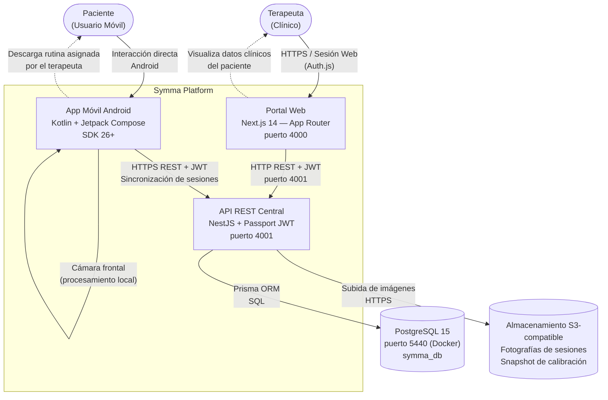
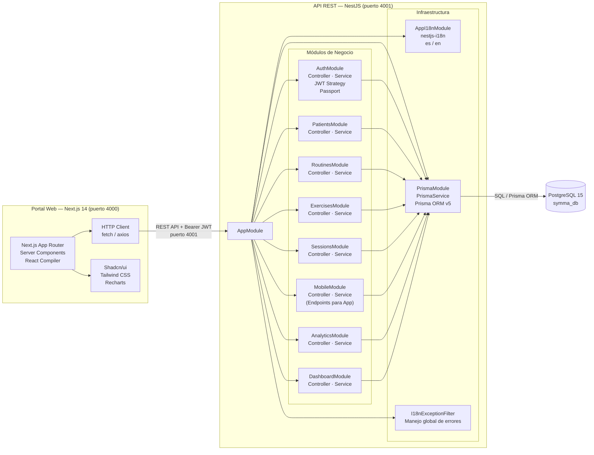
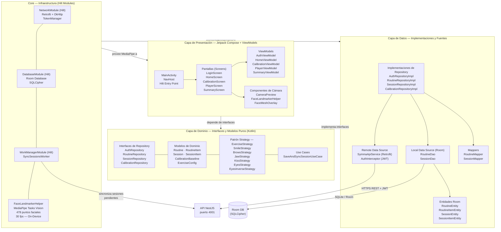
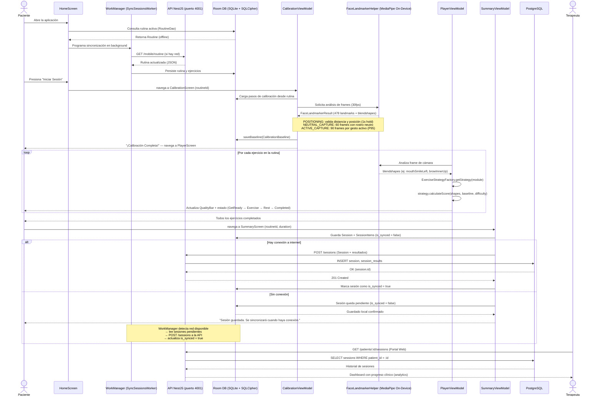

# Diagramas de Arquitectura — Symma Platform

**Proyecto:** Symma Platform — Ecosistema de Rehabilitación de Parálisis Facial  
**Versión:** 2.0.0  
**Fecha:** Mayo 2026

---

## 1. Arquitectura General del Sistema

El siguiente diagrama de nivel de contexto (C4 Model — Context Level) muestra los actores externos del sistema y las interacciones de alto nivel entre los tres subsistemas principales de Symma Platform: el Portal Web para terapeutas, la API REST central y la Aplicación Móvil para pacientes. El almacenamiento de datos se divide entre PostgreSQL (datos clínicos estructurados) y un servicio S3-compatible (evidencia fotográfica de las sesiones).

---

## 2. Diagrama de Componentes — Backend y Portal Web

El diagrama presenta la estructura interna del Backend (NestJS) y el Portal Web (Next.js). Cada módulo de NestJS sigue el patrón estándar del framework: un Controller que expone los endpoints REST, un Service que contiene la lógica de negocio y, cuando aplica, acceso directo a Prisma para la persistencia. El módulo `AppI18nModule` provee internacionalización global con soporte para inglés y español.

---

## 3. Diagrama de Componentes — Aplicación Móvil Android

El diagrama ilustra la arquitectura Clean Architecture de la aplicación Android. La regla de dependencia fluye en una sola dirección: la capa de Presentación depende de la capa de Dominio, y la capa de Datos implementa las interfaces definidas en el Dominio. El Core provee la infraestructura de inyección de dependencias (Hilt), la red (Retrofit) y la base de datos local (Room + SQLCipher). MediaPipe procesa los frames de la cámara completamente en el dispositivo, sin enviar video al servidor.

---

## 4. Flujo de una Sesión de Terapia

El diagrama de secuencia describe el ciclo de vida completo de una sesión de terapia, desde que el paciente abre la aplicación hasta que el terapeuta puede visualizar los resultados en el Portal Web. Se destacan los dos caminos posibles al terminar: sincronización exitosa inmediata y el mecanismo de reintento offline a través de WorkManager.

---

## 5. Decisiones Arquitectónicas Clave

### 5.1 Monorepo con Turborepo y pnpm

El proyecto adopta una estrategia de monorepo gestionada con **Turborepo** (orchestrador de tareas) y **pnpm** (gestor de dependencias con workspaces). Esto permite compartir definiciones de tipos TypeScript (`packages/shared-types`) y el esquema Prisma (`packages/database`) entre el Backend y el Portal Web, eliminando la duplicación de contratos y reduciendo los errores de integración entre capas.

La aplicación Android se aloja de manera co-localizada en `apps/mobile/` para facilitar la generación de tipos y mantener la coherencia del repositorio, aunque el ecosistema de build de Android (Gradle) es independiente del pipeline de Node.js.

### 5.2 Estrategia Offline-First en la App Móvil

La aplicación adopta un modelo **offline-first** donde la base de datos Room (SQLite cifrada con SQLCipher) es la fuente de verdad local. El flujo de datos sigue el patrón:

1. El paciente puede realizar sesiones completas sin conexión a internet.
2. La rutina asignada se descarga previamente y se persiste en Room.
3. Al finalizar una sesión, los resultados se guardan localmente con `is_synced = false`.
4. **WorkManager** monitorea la conectividad y ejecuta `SyncSessionsWorker` cuando hay red disponible, enviando las sesiones pendientes a la API en lotes.
5. La autenticación offline se resuelve mediante un PIN local cifrado almacenado en Room.

### 5.3 Visión por Computadora On-Device con MediaPipe

El motor de Computer Vision utiliza **MediaPipe Tasks Vision** (FaceLandmarker) ejecutándose **completamente en el dispositivo Android**, sin transmitir video o imágenes al servidor. Esto tiene dos implicaciones fundamentales:

- **Privacidad:** No se almacena ningún video. Solo se persiste un snapshot fotográfico del mejor intento por ejercicio.
- **Latencia cero de red:** El análisis ocurre a 30 fps sobre el stream en vivo de la cámara frontal, extrayendo 52 blendshapes que representan la geometría facial (ej. `mouthSmileLeft`, `browInnerUp`, `eyeBlinkRight`).

El modelo FaceLandmarker opera con 478 puntos de referencia facial y entrega los blendshapes normalizados que alimentan directamente las estrategias de ejercicio.

### 5.4 Clean Architecture en Android

La aplicación móvil implementa Clean Architecture con tres capas y la regla de dependencia estricta (las capas externas dependen de las internas, nunca al revés):

| Capa | Responsabilidad | Tecnología |
|---|---|---|
| **Presentación** | UI reactiva, estado de pantalla | Jetpack Compose, ViewModel, StateFlow |
| **Dominio** | Reglas de negocio, interfaces de repositorio | Kotlin puro, sin dependencias Android |
| **Datos** | Acceso a red y base de datos local | Retrofit, Room, DataStore |

La inyección de dependencias es gestionada por **Hilt** (Dagger 2) a través de módulos declarativos (`NetworkModule`, `DatabaseModule`, `WorkManagerModule`, `RepositoryModule`).

### 5.5 Patrón Strategy para el Motor de Ejercicios

El núcleo del motor de rehabilitación implementa el **Patrón Strategy** para abstraer el algoritmo de puntuación de cada tipo de ejercicio facial. La interfaz `ExerciseStrategy` define un único método `calculateScore(shapes, baseline, difficulty): Float`, y cada ejercicio tiene su propia implementación concreta:

| Estrategia | Ejercicio | Blendshapes evaluados |
|---|---|---|
| `SmileStrategy` | Sonrisa simétrica | `mouthSmileLeft`, `mouthSmileRight` |
| `BrowsStrategy` | Elevación de cejas | `browInnerUp`, `browOuterUpLeft`, `browOuterUpRight` |
| `JawStrategy` | Apertura mandibular | `jawOpen` |
| `KissStrategy` | Fruncimiento de labios | `mouthPucker` |
| `EyesStrategy` | Cierre de ojos | `eyeBlinkLeft`, `eyeBlinkRight` |
| `EyesInverseStrategy` | Apertura asimétrica | `eyeBlinkLeft`, `eyeBlinkRight` (invertida) |

`ExerciseStrategyFactory` selecciona la estrategia correcta en tiempo de ejecución según el `MobileModule` del `RoutineItem`, permitiendo extender el catálogo de ejercicios sin modificar el código del `PlayerViewModel`. El score calculado se normaliza contra el `CalibrationBaseline` del paciente (valor P95 capturado al inicio de cada sesión), lo que personaliza el umbral de éxito a la capacidad motora individual de cada usuario.
